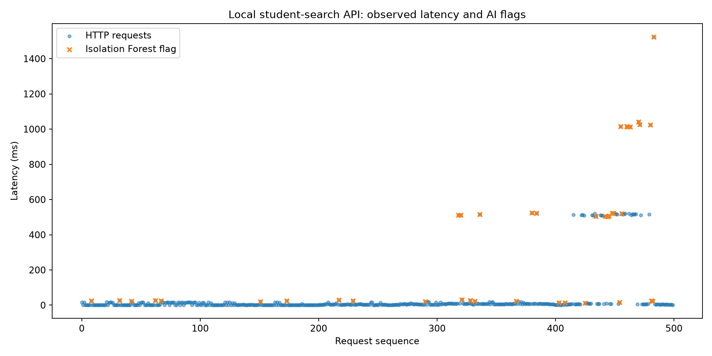

# Student Performance + AI Lab

Website thực hành **tra cứu sinh viên và kiểm thử hiệu năng có phân tích AI**, dùng Python, SQLite và 5.000 hồ sơ tổng hợp. Chạy trên localhost phục vụ học tập.

## Tài liệu nộp học phần

| Tài liệu | Nội dung |
| --- | --- |
| [Đặc tả yêu cầu](docs/DAC_TA_YEU_CAU.md) | Phạm vi, chức năng, tiêu chí chấp nhận |
| [Thiết kế hệ thống](docs/THIET_KE_HE_THONG.md) | Kiến trúc, database, API, thuật toán |
| [Báo cáo kiểm thử](docs/BAO_CAO_KIEM_THU.md) | Kiểm tra đã chạy, số liệu và giới hạn |
| [Hướng dẫn ban đầu](docs/README_ORIGINAL.md) | README tiếng Anh có sẵn được giữ lại |

Tài liệu tiếng Việt được bổ sung từ mã nguồn và lần chạy thử ngày 16/10/2026. Hiện có tra cứu; chưa có đăng nhập, quản lý điểm, thêm/sửa/xóa sinh viên.

## Cấu trúc mã nguồn

| File | Vai trò |
| --- | --- |
| `server.py` | Máy chủ HTTP, giao diện, API, khởi tạo SQLite |
| `benchmark.py` | 500 yêu cầu tại 5 mức luồng đồng thời |
| `analyze.py` | Isolation Forest, ngưỡng cố định và biểu đồ |
| `k6_search.js` | Kịch bản k6 tùy chọn |
| `requirements.txt` | Thư viện phân tích |
| `results.csv` | Dữ liệu đo lần chạy thử |
| `analyzed_results.csv` | Dữ liệu kèm cờ cảnh báo |
| `measured_chart.png` | Biểu đồ kết quả |

## Chạy trên Windows / VS Code

Cài Python 3.10 trở lên và Git. Clone repository, mở terminal tại thư mục dự án:

```powershell
python -m venv .venv
.\.venv\Scripts\python.exe -m pip install -r requirements.txt
.\.venv\Scripts\python.exe server.py
```

Mở http://127.0.0.1:18765 trên cùng máy. `students.db` tự tạo với 5.000 hồ sơ mẫu nếu chưa có; không cần tải database riêng. Nếu Windows nhận lệnh `py`, dùng `py -3 -m venv .venv` ở bước đầu. Server và benchmark chỉ cần thư viện chuẩn; các gói cài thêm dành cho phân tích.

Giữ server chạy, mở terminal thứ hai tại thư mục dự án:

```powershell
.\.venv\Scripts\python.exe benchmark.py
.\.venv\Scripts\python.exe analyze.py
```

Hai lệnh ghi lại CSV và biểu đồ, cần sao lưu kết quả cũ để so sánh. Dừng server bằng Ctrl+C.

## Độ trễ có kiểm soát

Dừng server hiện tại, sau đó trong PowerShell:

```powershell
$env:LAB_DELAY_MS = "120"
.\.venv\Scripts\python.exe server.py
```

Chạy lại benchmark từ terminal khác để so sánh baseline đã lưu. Đây là độ trễ chủ động chèn, không phải lỗi tự nhiên. Sau thử nghiệm, dừng server và xóa biến trước lần chạy bình thường:

```powershell
Remove-Item Env:LAB_DELAY_MS -ErrorAction SilentlyContinue
```

## k6 tùy chọn

Cài k6, khởi động server, chạy:

```powershell
k6 run k6_search.js
```

k6 và benchmark Python có mô hình tải khác nhau, không coi số liệu là tương đương. Kịch bản k6 chưa được chạy trong báo cáo hiện tại.

## Kết quả và giới hạn

Lần chạy đã gửi 500 yêu cầu, toàn bộ trả HTTP 200. P95 tại 50 luồng khoảng 1.015 ms; xem bảng chi tiết trong [báo cáo](docs/BAO_CAO_KIEM_THU.md).



- Server chỉ lắng nghe loopback, chưa triển khai production. Link GitHub để đọc tài liệu/tải mã nguồn, không phải địa chỉ website đang chạy.
- Số luồng là số client đồng thời tối đa, không phải RPS hoặc số người dùng thực.
- API trả tối đa 25 hồ sơ; count là số hồ sơ trả về.
- Isolation Forest huấn luyện và chấm cùng dữ liệu để khảo sát, contamination=0.08; chưa đánh giá độc lập.
- Cờ AI không chứng minh precision, recall, F1, nguyên nhân lỗi hoặc AI tốt hơn ngưỡng cố định.
- Đánh giá nghiêm túc cần lặp phép đo, warm-up, kiểm soát tải máy, đo CPU/RAM và nhãn độc lập.
